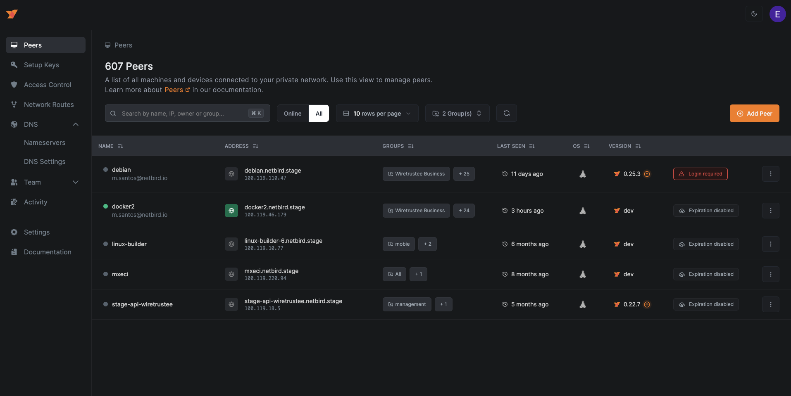
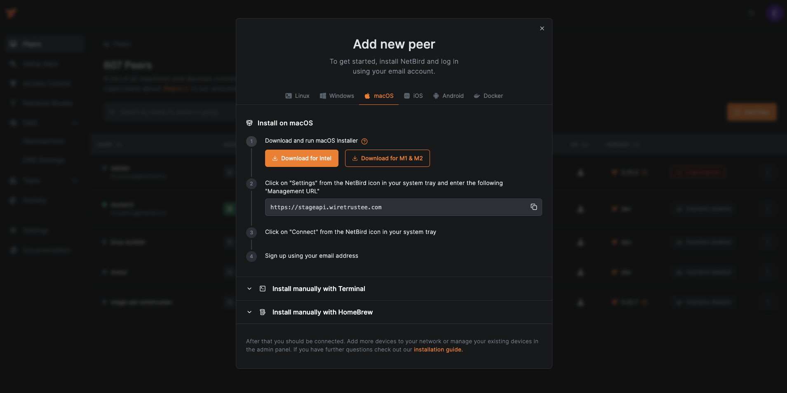

# WardenClyffe Dashboard

## Branding build boundaries

The dashboard uses `src/components/WardenClyffeLogo.tsx` and the cyan
`wardenclyffe` Tailwind palette. The embedded sign-in pages belong to the
combined service, not this dashboard image. Their shared header references
`idp/dex/web/themes/light/logo.svg`, `favicon.svg`, and `styles.css`, embedded
by `idp/dex/web/web.go`. Rebuild the combined image after changing these assets;
rebuilding only the dashboard does not update sign-in pages.

Go dependency replacement paths identify the repositories that actually publish
the pinned revisions; they are not product branding. Keep those sources reachable.
Renaming a replacement to a WardenClyffe fork requires publishing that fork and
its referenced revision first, otherwise the combined service cannot rebuild.

This project is the UI for WardenClyffe's Management service.

**Hosted version:** https://app.wardenclyffe.app/

See [WardenClyffe repo](https://github.com/shippin/wardenclyffe)

## Why?

The purpose of this project is simple - make it easy to manage VPN built with [WardenClyffe](https://github.com/shippin/wardenclyffe).
The dashboard makes it possible to:

- track the status of your peers
- remove peers
- manage Setup Keys (to authenticate new peers)
- list users
- define access controls

## Some Screenshots




## Technologies Used

- NextJS
- ReactJS
- Tailwind CSS
- [React Flow](https://reactflow.dev/) for the Control Center
- [Arktype](https://arktype.io/) for strict scripted-event and MCP payload contracts
- Auth0
- Nginx
- Docker
- Let's Encrypt

## Scripted event contracts

Dashboard scripted UI events (announcements/tooltips/popups) and MCP response
payloads use strict Arktype contracts in
`src/modules/scripted-events/contracts.ts`, parsed by
`src/modules/scripted-events/parser.ts`.

The orchestrator lane model in `src/modules/scripted-events/orchestrator.ts`
partitions visible UI events (for Clyffy/council surfaces) from background
data-sink events used for behind-the-scenes optimization and testing
comparisons.

The live dashboard now mounts a persistent assistant overlay from
`src/modules/scripted-events/ScriptedAssistantOverlay.tsx`, and an admin
control surface in Agent Network Configuration (`?tab=scripted-events`) via
`src/modules/scripted-events/ScriptedEventsAdminPanel.tsx`.

Phase 1 canonical UI foundation now lives in:

- `src/components/canonical/CanonicalButton.tsx`
- `src/components/canonical/CanonicalCard.tsx`
- `src/components/canonical/PersistentAssistantOverlay.tsx`
- `src/app/globals.css` fluid clamp tokens (`--wc-*`) for responsive sizing
  without breakpoint-driven typography/spacing.

## How to run

Disclaimer. We believe that proper user management system is not a trivial task and requires quite some effort to make it right. Therefore we decided to
use Auth0 service that covers all our needs (user management, social login, JWT for the management API).
Auth0 so far is the only 3rd party dependency that can't be really self-hosted.

1. Install [Docker](https://docs.docker.com/get-docker/)
2. Register [Auth0](https://auth0.com/) account
3. Running WardenClyffe UI Dashboard requires the following Auth0 environmental variables to be set (see docker command below):

   `AUTH0_DOMAIN` `AUTH0_CLIENT_ID` `AUTH0_AUDIENCE`

   To obtain these, please use [Auth0 React SDK Guide](https://auth0.com/docs/quickstart/spa/react) up until "Configure Allowed Web Origins"

4. WardenClyffe UI Dashboard uses WardenClyffe's Management Service HTTP API, so setting `WARDENCLYFFE_MGMT_API_ENDPOINT` is required. Most likely it will be `http://localhost:33071` if you are hosting Management API on the same server.
5. Run docker container without SSL (Let's Encrypt):

   ```shell
   docker run -d --name wardenclyffe-dashboard \
     --rm -p 80:80 -p 443:443 \
     -e AUTH0_DOMAIN=<SET YOUR AUTH DOMAIN> \
     -e AUTH0_CLIENT_ID=<SET YOUR CLIENT ID> \
     -e AUTH0_AUDIENCE=<SET YOUR AUDIENCE> \
     -e WARDENCLYFFE_MGMT_API_ENDPOINT=<SET YOUR MANAGEMENT API URL> \
     shippin/wardenclyffe/dashboard:main
   ```

6. Run docker container with SSL (Let's Encrypt):

   ```shell
   docker run -d --name wardenclyffe-dashboard \
     --rm -p 80:80 -p 443:443 \
     -e NGINX_SSL_PORT=443 \
     -e LETSENCRYPT_DOMAIN=<YOUR PUBLIC DOMAIN> \
     -e LETSENCRYPT_EMAIL=<YOUR EMAIL> \
     -e AUTH0_DOMAIN=<SET YOUR AUTH DOMAIN> \
     -e AUTH0_CLIENT_ID=<SET YOUR CLEITN ID> \
     -e AUTH0_AUDIENCE=<SET YOUR AUDIENCE> \
     -e WARDENCLYFFE_MGMT_API_ENDPOINT=<SET YOUR MANAGEMENT API URL> \
     shippin/wardenclyffe/dashboard:main
   ```

## How to run local development

1. Install [Node](https://nodejs.org/)
2. Create and update the `.local-config.json` file. This file should contain values to be replaced from `config.json`
3. Run `npm install` to install dependencies
4. Run `npm run dev` to start the development server

Open [http://localhost:3000](http://localhost:3000) with your browser to see the result.

You can start editing by modifying the code inside `src/..`  
The page auto-updates as you edit the file.

## How to migrate from old dashboard (v1)

The new dashboard comes with a new docker image `shippin/wardenclyffe/dashboard:main`.  
To migrate from the old dashboard (v1) `wiretrustee/dashboard:main` to the new one, please follow the steps below.

1. Stop the dashboard container `docker compose down dashboard`
2. Replace the docker image name in your `docker-compose.yml` with `shippin/wardenclyffe/dashboard:main`
3. Recreate the dashboard container `docker compose up -d --force-recreate dashboard`
